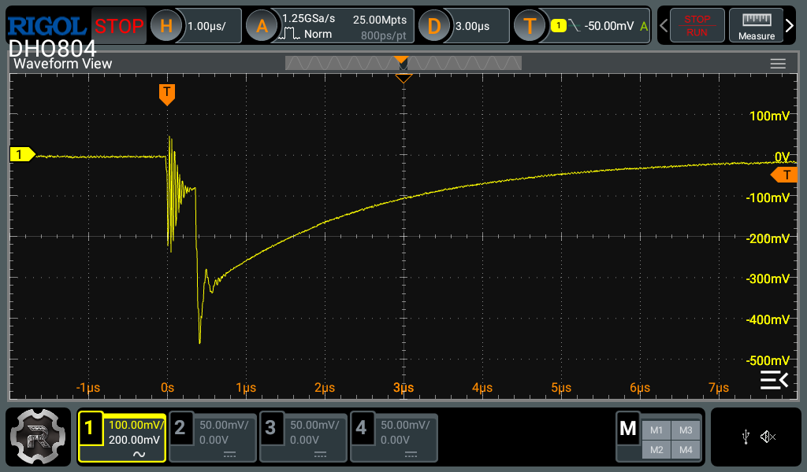
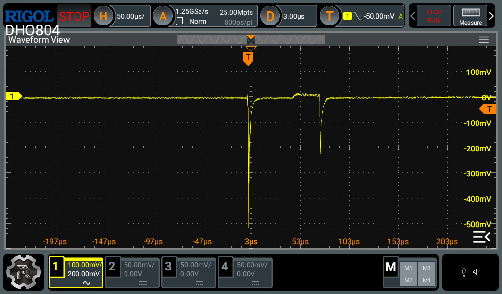
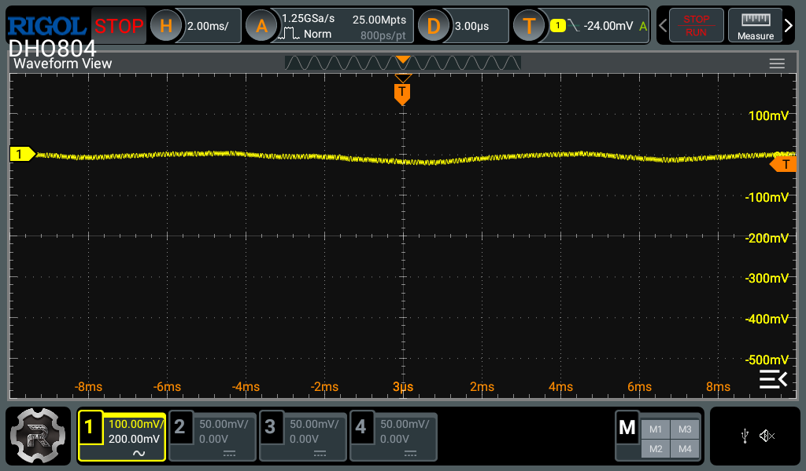
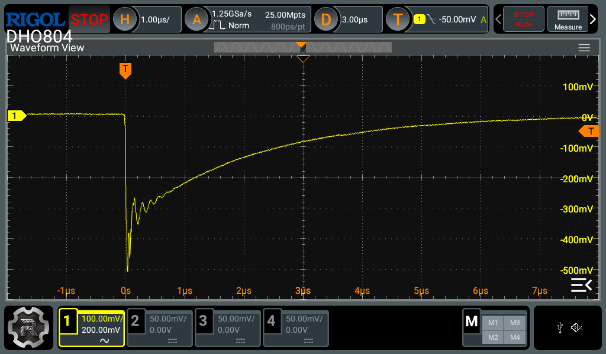
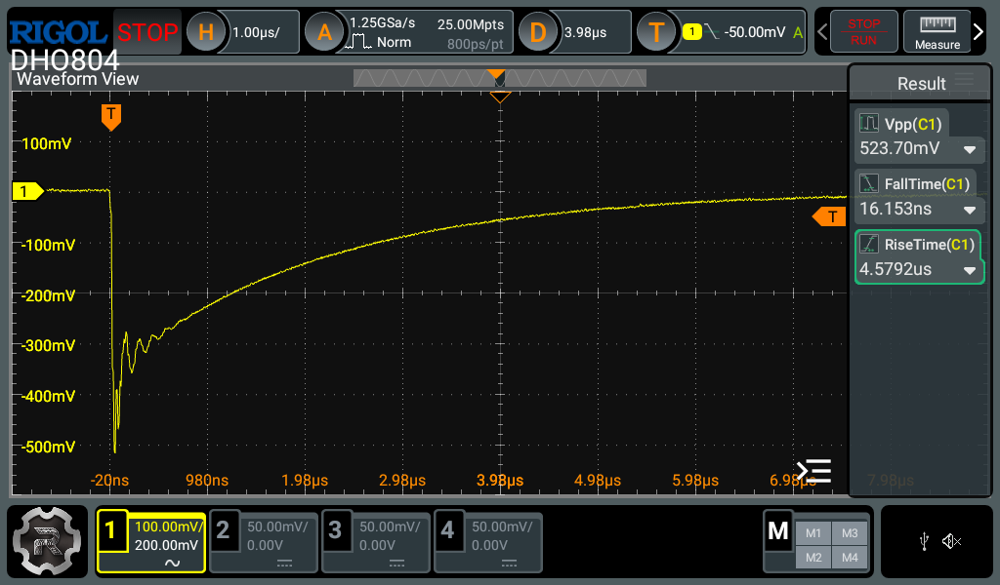
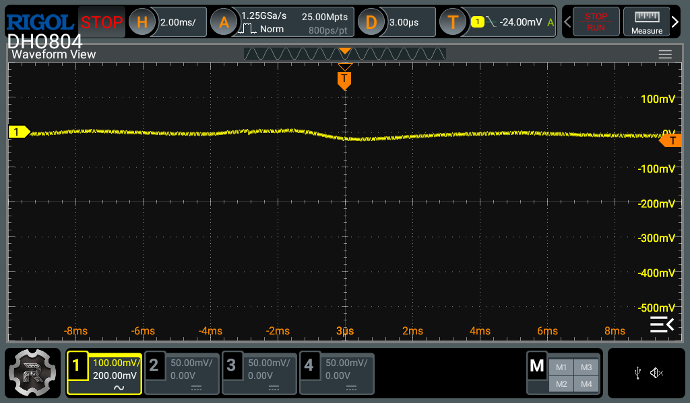

# PTT transient coupling into the ring

**M9OMS MyTiMic** · Test report, November 2026 · [Back to README](../README.md)

## Possible cause of false “G” detection

According to the manual, the QMX detects a GPS by monitoring the ring contact for 9600-baud serial data. The ring contact is also used for the microphone signal.

Working hypothesis: when the PTT is pressed or released, its contacts may bounce briefly, creating a series of fast transitions on the tip contact. Some of this transient energy could couple into the ring through the plug, cable, or circuit board and be interpreted by the QMX as serial data.

The QMX’s internal 1 nF capacitance on the paddle lines may not provide sufficient debounce. Assuming an internal pull-up of approximately 40 kΩ, the corresponding time constant is about 40 µs, compared with typical contact-bounce durations of 1–10 ms.

## Proposed solution

The following components can be added to the microphone:

- **R1:** in series between the PTT terminal and Tip.
- **C2:** between the Tip and Sleeve, on the jack side of R1.
- **C1:** a C0G capacitor between the Ring and Sleeve.

The network is intended to reduce PTT contact bounce and slow the resulting transitions, thereby reducing fast transients coupled into the ring. C1 is intended to further suppress any remaining high-frequency spikes or RF on the ring.

R1 also limits the capacitor’s discharge current through the switch contacts. Assuming a pull-up of approximately 40 kΩ, the voltage at the tip when the PTT is pressed remains a clean logic low. Because the components are located on the microphone PCB, paddle operation is unaffected.

QRP Labs publishes the complete QMX schematic, which was used to calculate and select the values of R1, C1, and C2 for the prototype. This design should not be assumed to perform identically with every radio that uses the same TRS pinout. Other radios may have different input circuits or electrical characteristics, so their performance and compatibility should be evaluated separately.

## Measurement setup

To test this theory, two PCBs were ordered from JLCPCB. One containing C1, C2 and R1 as described (we will refer to this as the MyTiMic PCB), and the other without those components (we will refer to this as the control PCB). They were otherwise identical - ground planes, ground stitching and mechanical components were not changed. They were bench tested with a QMX. Two different tests were carried out.

1. With the “Mic Test” in diagnostics enabled.
2. With the QMX transmitting into a dummy load, on 14.150 MHz.

This allowed measurements to be taken with and without RF, allowing the RF component to be isolated.

The electret was absent from both PCBs. This excluded audio as a source of disturbance on the Ring, allowing the PTT circuit to be assessed in isolation.

The Ring-to-Sleeve signal was measured on the QMX PCB using an oscilloscope probe with a short ground spring. Channel 1 was set to 10×, AC coupling, 20 MHz bandwidth. The single-capture trigger was DC-coupled, set to a falling edge at −50 mV, unless otherwise stated.

The QMX was being powered by a bench supply, set to 12.00 V.

The same TRS cable was used in all tests - only the microphone PCBs were changed.

## Test results 1

These tests were conducted in the diagnostics menu, with “mic test” enabled. No RF was emitted from the QMX.

The control PCB exhibited a negative voltage spike of approximately -500 mV. This was repeated on all 10 PTT button presses. Occasionally, a negative voltage spike was exhibited upon button release. Very occasionally, more than one contact bounce was exhibited on PTT button press.

*Control PCB, no RF (Mic Test in Diagnostics Menu).*

*Control PCB. Very occasional multiple contact bounce.*

*Control PCB. Occasional PTT release spike:*

The MyTiMic PCB was unable to trigger a single capture at -50 mV on any of 10 PTT button presses. The trigger was adjusted to -24 mV, with no successful acquisition.

Whilst in the diagnostics menu, RF was introduced without the PTT button being pressed. This was achieved using the “hardware tests” menu, by pressing “T” on the keyboard. The exact frequency is unknown, however the 20 m band was enabled in the menu.

Both PCBs failed to acquire a single capture with the trigger set to -50 mV. The trigger was lowered to -24 mV, which enabled both PCBs to successfully acquire a capture. Both traces were very similar.

*MyTiMic PCB, RF introduced via the diagnostics menu (no PTT press), trigger −24 mV.*

## Test results 2

The QMX was disconnected from the computer to conduct these tests. The operating frequency was set to 14.150 for consistency in all tests. PTT button presses during this test would activate the PA.

The control PCB exhibited the same negative voltage spike. This was repeated on all 10 PTT button presses. The same occasional spike was visible upon button release.

*Control PCB, transmitting. Typical coupling, very similar to the no RF capture.*

*Control PCB, transmitting. Typical trace, with measurements taken via cursors.*

The MyTiMic PCB was unable to trigger a single capture at -50 mV. With the trigger adjusted to -24 mV, a successful acquisition was captured. This indicates that a small RF-related component temporarily couples onto the ring when transmitting.

*MyTiMic PCB, normal TX, trigger −24 mV. Very similar to the result forced by pressing "T" in the hardware tests menu.*

## Summary

The additional components reduced coupled spikes on the Ring below the −24 mV trigger threshold, a reduction of at least 20× (26 dB). There may be a benefit to users who wish to keep the GPS protection enabled. Further field testing can help to establish whether this eliminates the false “G” message. Additional value may also be observed by enabling the user to reduce the PTT delay in firmware - further field tests can establish whether mic Thump/Pop is reduced.

## Further tests

The performance of different TRS cables can be established using the same tests.

The control PCB already includes stitched ground planes which isn't typically seen on hobbyists boards. Further tests will establish their benefit compared to boards that use simple traces, particularly with Ring coupling and RF immunity.

---

