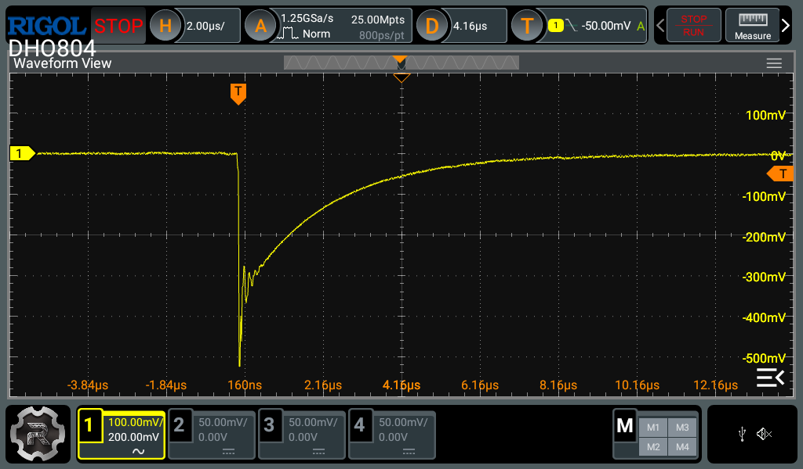
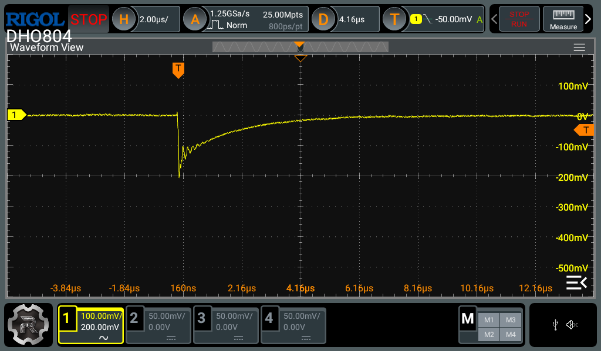
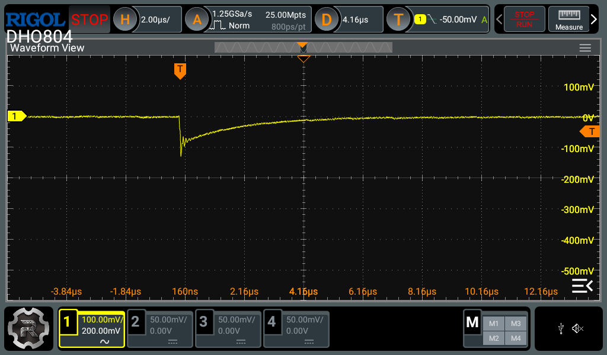

# Investigating PTT transients: part two

**M9OMS MyTiMic** · Oscilloscope measurements, November 2026 · [Back to README](README.md) · [Part one](2026-11-ptt-transient1.md)

## Background

[Part one](2026-11-ptt-transient1.md) showed that pressing the microphone's PTT button couples a transient onto the Ring. Adding two capacitors and a resistor to the microphone PCB eliminated it.

This document examines a single variable: the effect of the TRS cable on that transient.

## Cables tested

Three cables were tested, each 1 m long:

1. **Control cable:** the cable used throughout part one.
2. **CPC cable A:** supplied by CPC, with a published datasheet.
3. **CPC cable B:** supplied by CPC, with a published datasheet. It shares the construction of cable A, with the addition of individually screened cores in a figure-8 configuration (see Cable construction, below).

| Cable | Source | Part number | Construction | Length |
| --- | --- | --- | --- | --- |
| Control | As part one | — | [TO FILL] | 1 m |
| CPC cable A | CPC | [TO FILL] | [TO FILL] | 1 m |
| CPC cable B | CPC | [TO FILL] | Figure-8, individually screened cores [TO FILL] | 1 m |

## Measurement setup

All three cables were tested with the control PCB, which has no decoupling and no PTT debounce circuit.

The method matched Test 3 of part one: transmitting into a dummy load on 14.150 MHz by pressing the PTT button.

As before, no electret was fitted. Any transient on the Ring therefore comes from the PTT circuit alone, coupled through the cable.

The Ring-to-Sleeve signal was measured on the QMX PCB using an oscilloscope probe with a short ground spring. Channel 1 was set to 10×, AC coupling. The single-capture trigger was DC-coupled, on a falling edge at −50 mV.

The QMX was powered from a bench supply at 12.00 V.

## Test results 1: Control cable

An excursion of approximately −500 mV appeared on every PTT press, matching part one and confirming that the measurement is repeatable.

*Control PCB, control cable. Excursion of approximately −500 mV, as in part one.*

## Test results 2: CPC cable A

The excursion fell by more than half, to just over −200 mV.

*Control PCB, CPC cable A. Excursion just over −200 mV.*

## Test results 3: CPC cable B

The excursion fell further, to approximately −125 mV.

*Control PCB, CPC cable B. Excursion of approximately −125 mV.*

## Cable construction

[TO FILL: construction details from each datasheet.]

In cable B, each core has its own screen, connected to the Sleeve. A grounded screen therefore runs between the Tip and Ring conductors along the full length of the cable, reducing the capacitive coupling between them.

## Summary

| Cable | Excursion (approx.) | Relative to control |
| --- | --- | --- |
| Control | −500 mV | — |
| CPC cable A | just over −200 mV | ≈ 2.4× lower (≈ 8 dB) |
| CPC cable B | −125 mV | ≈ 4× lower (≈ 12 dB) |

The choice of TRS cable clearly affects how much of the PTT transient couples onto the Ring. No cable removed it entirely; for comparison, the MyTiMic PCB in part one reduced it below −24 mV.

This document covers Ring transients only. Further tests could assess other aspects of performance, such as RF interference and common-mode noise.

Headphone and microphone cables are usually chosen for flexibility, how well they coil and how they feel in the hand. Their electrical construction matters too. A cable with a published datasheet shows what you are buying and how it is likely to perform. Such cables may not look like typical consumer TRS leads, but they offer better electrical characteristics.

---
